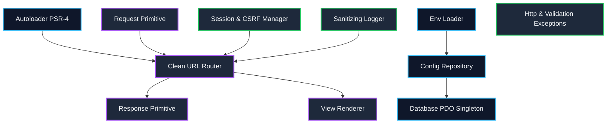

# WTSBill ERP — Architecture Specification

**Document Version:** 1.0.0  
**Generated Date:** 2026-10-10  
**Project Objective:** Enterprise Billing, Indian GST Accounting, and Multi-Tenant Inventory management system built on Native PHP 8+ and MySQL/MariaDB with zero external runtime framework dependencies.

---

## 1. Architectural Principles

1. **Framework Independence:** Built completely on Native PHP 8+ without dependencies on Laravel, Symfony, or Illuminate components. This eliminates runtime bloat, breaking framework upgrades, and vendor security attack vectors.
2. **Prepared Statements & SQL Injection Immunity:** All database operations execute through Native PDO prepared statements with strict parameter binding. Raw string concatenation in SQL queries is prohibited.
3. **Database Error Redaction:** Raw SQLSTATE exceptions and database schema names are intercepted and sanitized before emitting responses to prevent data structure leaks.
4. **Statutory Calculation Invariants:**
   - Indian GST: Intra-State transactions split tax equally between CGST and SGST (50% each); Inter-State transactions levy IGST (100%).
   - Double-Entry Accounting: For every transaction, $\sum \text{Debit} = \sum \text{Credit}$.
   - Automatic statutory round-off: Grand totals round to whole rupees with adjustment recorded in the round-off ledger.
5. **Multi-Tenant Context Scoping:** All business entity queries enforce strict company and branch isolation through `company_id` and `branch_id` parameters resolved from the authenticated session.

---

## 2. Foundational Core Primitives (`app/Core/`)

### 2.1 Autoloader (`app/Core/Autoloader.php`)
- Implements the PSR-4 standard with native `spl_autoload_register`.
- Maps `WTSBill\` to `app/`.
- Maintains an alias for `App\` to ensure backwards compatibility with legacy tests.

### 2.2 Environment & Configuration (`app/Core/Env.php`, `app/Core/Config.php`)
- `Env::load()` parses `.env` files into `$_ENV` and `putenv()`.
- `Config::loadFromDirectory()` caches all PHP files under `config/` (`app.php`, `database.php`, `session.php`, `security.php`).
- Supports dot-notation retrieval (`Config::get('database.connections.mysql.host')`).

### 2.3 HTTP Request & Response Primitives (`app/Core/Request.php`, `app/Core/Response.php`)
- `Request::capture()` gathers GET, POST, server headers, client IP, and parses raw JSON bodies when `Content-Type: application/json` is present.
- `Response` sets HTTP status codes, security headers (`X-Content-Type-Options: nosniff`, `X-Frame-Options: SAMEORIGIN`, `X-XSS-Protection: 1; mode=block`), and provides JSON envelopes:
  - Success: `{"success": true, "message": "...", "data": ...}`
  - Error: `{"success": false, "message": "...", "errors": ...}`

### 2.4 Router (`app/Core/Router.php`)
- Compiles clean URL patterns into regular expressions with named parameters (`/customers/{id}` $\rightarrow$ `(?P<id>[^/]+)`).
- Supports route grouping with path prefixes (`/api/v1`) and group middleware stacks.
- Dispatches to Closures, controller method tuples (`[Controller::class, 'action']`), or direct view templates.

### 2.5 Database Layer (`app/Core/Database.php`)
- Native PDO connection singleton with `PDO::ATTR_ERRMODE => PDO::ERRMODE_EXCEPTION` and `PDO::ATTR_EMULATE_PREPARES => false`.
- High-level CRUD helpers (`select`, `selectOne`, `insert`, `update`, `delete`).
- ACID transactions with nested transaction support via MySQL `SAVEPOINT` directives.

### 2.6 Session & CSRF Manager (`app/Core/Session.php`)
- Configures secure cookie parameters: `httponly=true`, `samesite=Lax`, strict cookie mode.
- Cryptographic CSRF token generation (64-character hexadecimal) and constant-time validation (`hash_equals`).
- Flash message lifecycle management.
- Multi-tenant session state helpers (`setTenantContext`, `getCompanyId`, `getBranchId`).

### 2.7 Template Renderer (`app/Core/View.php`)
- Resolves template paths within the `views/` directory.
- Hardened against directory traversal attacks: validates that the resolved path starts with the base views directory using `realpath()`.
- Supports layout encapsulation (`View::renderWithLayout()`).

### 2.8 Logger (`app/Core/Logger.php`)
- Zero-dependency file logger writing to `storage/logs/wtsbill-{Y-m-d}.log`.
- Automatically redacts sensitive parameters (`password`, `secret`, `jwt_secret`, `token`, `authorization`) from both strings and structured context arrays.

### 2.9 Exceptions (`app/Core/Exceptions/`)
- `HttpException`: Encapsulates HTTP status codes (400, 401, 403, 404, 405, 500) and headers.
- `ValidationException`: Specialized 422 Unprocessable Entity exception carrying a structured errors dictionary.

---

## 3. Request Lifecycle

1. **HTTP Entry:** Request arrives at `public/index.php`.
2. **Bootstrap:** `Autoloader::register()`, `Env::load()`, `Config::loadFromDirectory()`, and paths are initialized.
3. **Capture:** `Request::capture()` parses the global request state.
4. **Route Loading:** `routes/web.php` and `routes/api.php` register handlers on `$router`.
5. **Dispatch:** `$router->dispatch($request)` matches routes, executes middleware, and calls the handler.
6. **Response Emission:** `$response->send()` outputs security headers and the response body.
