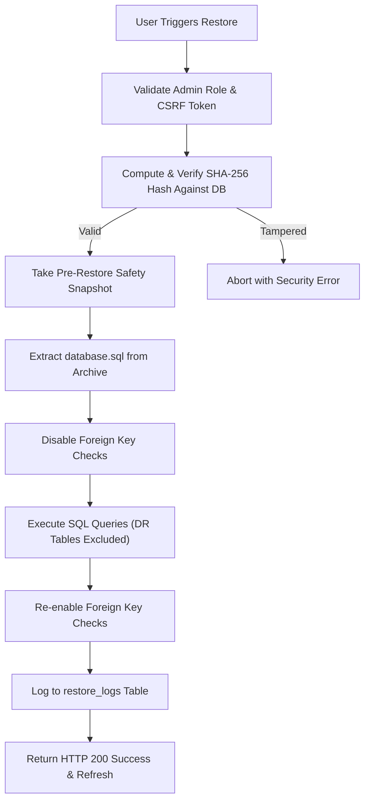

# WTSBill ERP — Automated Weekly Backup & Disaster Recovery Guide

**Document Version:** 1.0.0  
**Effective Date:** 2026-11-04  
**Author:** Senior Systems Architect & Database Engineer  
**Applies To:** WTSBill Enterprise Multi-Tenant ERP  

---

## 1. Architectural Overview

WTSBill ERP features a high-performance, pure-PHP backup and disaster recovery engine requiring zero external dependencies (such as `mysqldump` or command-line zip utilities). The solution is engineered for 100% platform portability across Windows (XAMPP / IIS) and Linux (Apache / Nginx) production stacks.

### Core Guarantees:
- **Pure PHP Engine:** Uses Native PDO with buffered cursors for MySQL/MariaDB database exports and `\ZipArchive` for compression.
- **Tamper-Evident Integrity:** Every backup generates a cryptographic SHA-256 hash stored in `backup_records` and verified prior to any download or restore.
- **DR Safety Snapshot:** Before executing any database restoration, the engine takes an automatic snapshot of the existing state, preventing catastrophic data loss during rollbacks.
- **DR Metadata Preservation:** Disaster recovery ledger tables (`backup_records`, `restore_logs`, `audit_cleanup_logs`) are protected during restoration to ensure historical audit trails are never overwritten.
- **Web-Root Isolation:** Archives are stored strictly in `storage/backups/`, shielded with Apache `.htaccess` deny rules and nginx access blocks. Direct web access returns HTTP 403. Downloads require an authenticated admin session via `GET /settings/backups/{id}/download`.

---

## 2. Backup Archive Structure

Each generated backup archive is named according to standard ISO timestamps:  
`storage/backups/WTSBill_Backup_YYYY-MM-DD_HH-MM-SS.zip`

Inside each ZIP archive:
```
WTSBill_Backup_2026-11-04_15-30-00.zip
├── database.sql                  # Complete SQL schema & data dump
├── audit_logs_archive.json       # JSON export of audit trail prior to cleanup
├── config_summary.json           # Sanitized application settings (passwords redacted)
├── manifest.json                 # Verification metadata & checksums
└── uploads/                      # System attachments, signatures & company logos
    ├── logos/
    └── documents/
```

### Manifest Schema (`manifest.json`):
```json
{
  "system": "WTSBill ERP",
  "version": "4.5.0",
  "created_at": "2026-11-04 15:30:00",
  "type": "AUTOMATIC_WEEKLY",
  "created_by": "System Scheduler",
  "company_id": 1,
  "tables_count": 48,
  "sha256": "3a8f9c1e7d2b5a4f6e8c0d1b3a5f7e9a2c4b6d8e0f1a3c5e7b9d1f3a5c7e9b1d"
}
```

---

## 3. Automated Weekly Scheduler

The backup engine includes a standalone CLI scheduler runner located at `bin/scheduler.php`.

### CLI Commands:
```bash
# Run weekly automated backup
php bin/scheduler.php backup --weekly

# Run manual on-demand backup
php bin/scheduler.php backup --manual

# Run post-backup atomic audit log cleanup
php bin/scheduler.php cleanup-audit --retention-days=7

# Execute combined weekly pipeline (Backup -> Verify -> Archive -> Purge Audit)
php bin/scheduler.php run-all
```

### Windows Task Scheduler Setup:
1. Open **Task Scheduler** (`taskschd.msc`).
2. Create Basic Task: `WTSBill Weekly Backup`.
3. Trigger: **Weekly** on Sunday at 02:00 AM.
4. Action: **Start a program**.
   - Program/script: `C:\xampp\php\php.exe`
   - Add arguments: `c:\xampp\htdocs\WTSBill\bin\scheduler.php run-all`
   - Start in: `c:\xampp\htdocs\WTSBill`
5. Select **Run whether user is logged on or not** with highest privileges.

### Linux Crontab Setup:
```cron
# Run WTSBill ERP automated backup every Sunday at 02:00 AM
0 2 * * 0 /usr/bin/php /var/www/wtsbill/bin/scheduler.php run-all >> /var/log/wtsbill_scheduler.log 2>&1
```

---

## 4. Disaster Recovery & Safe Restore Procedure

### UI Restoration:
1. Navigate to **Settings > Backup & Disaster Recovery** (`/settings?tab=backup`).
2. Locate the target backup in the **Backup History Table**.
3. Click **Restore**.
4. Review the modal confirmation warning explaining that an automated safety snapshot will be generated.
5. Click **Confirm Restore**.

### Server-Side Restore Pipeline:


---

## 5. Post-Backup Audit Log Retention Policy

To maintain database indexing efficiency and storage performance without violating regulatory compliance, WTSBill ERP pairs backup creation with atomic log archiving and pruning.

### Rules of Engagement:
1. **Zero Data Loss Invariant:** If backup generation fails or checksum verification fails, audit log cleanup is **immediately aborted**.
2. **Archived First:** Eligible audit logs are exported into `audit_logs_archive.json` inside the backup ZIP before any database rows are deleted.
3. **Retention Threshold:** Default retention window is **7 days**. Logs newer than 7 days are never purged.
4. **Security Exemption:** High-severity security events (`AUTH_FAILURE`, `PERMISSION_VIOLATION`, `UNAUTHORIZED_ACCESS`, `RESTORE_EXECUTION`) are permanently retained in `audit_logs`.
5. **Cleanup Trail:** Every purge action records an audit record in `audit_cleanup_logs` specifying `records_purged`, `oldest_log_date`, `cutoff_timestamp`, and `backup_id`.

