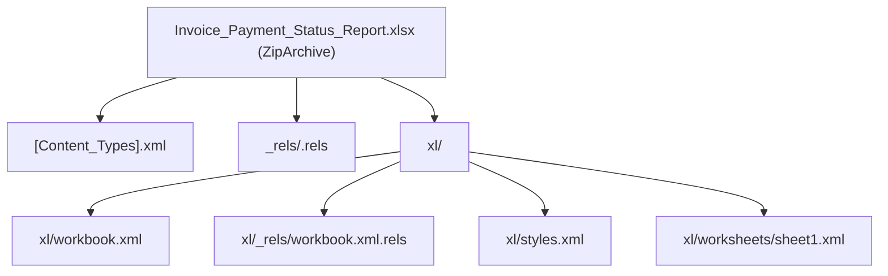

# WTSBill ERP — Invoice Payment Status Excel (.xlsx) Export Specification

## 1. Overview & Architecture

The Invoice Payment Status Report provides native high-speed export to genuine Microsoft Excel (`.xlsx`) format. To ensure maximum reliability, security, and zero external dependency risk, the workbook is generated programmatically using PHP's native `ZipArchive` extension and strict OpenXML 2006 spreadsheet markup standards.

> [!NOTE]
> The exported file is a genuine compressed Office Open XML container (PKZIP format containing XML parts), **not** a renamed CSV, TSV, or HTML table. It opens seamlessly without warnings in Microsoft Excel, Google Sheets, LibreOffice Calc, and Apple Numbers.

---

## 2. Technical Endpoint & HTTP Headers

- **Route**: `GET /reports/invoice-payment-status/export`
- **Controller Action**: `\WTSBill\Controllers\ReportController::invoicePaymentStatusExport()`
- **Service Generator**: `\WTSBill\Services\InvoicePaymentStatusReportService::generateExcelWorkbook()`
- **Permissions**: Requires authenticated session with `reports.view` and `reports.export` capabilities.

### HTTP Response Headers
```http
HTTP/1.1 200 OK
Content-Type: application/vnd.openxmlformats-officedocument.spreadsheetml.sheet
Content-Disposition: attachment; filename="Invoice_Payment_Status_Report_2026-11-07.xlsx"
Content-Transfer-Encoding: binary
Cache-Control: max-age=0, must-revalidate, no-cache, no-store
Pragma: public
```

---

## 3. Workbook Structure & Packaging

The `.xlsx` file is assembled in-memory with the following OpenXML part hierarchy:



### 1. `[Content_Types].xml`
Declares MIME types for worksheets, shared strings, workbook, and styling definitions.

### 2. `xl/styles.xml`
Defines fonts, fills, borders, and number format definitions:
- **Style 0**: Default general text (Calibri 11pt).
- **Style 1**: KPI Card Header (Calibri 10pt Bold, dark muted slate).
- **Style 2**: KPI Card Value / Title (Calibri 14pt Bold, dark forest green `#051F20`).
- **Style 3**: Table Column Header (Calibri 11pt Bold, white text, forest green fill `#0B2B26`, centered, thin borders).
- **Style 4**: Standard Text Cell (thin border, left-aligned).
- **Style 5**: Currency Number Cell (`type="n"`, format `#,##0.00`, thin border, right-aligned).
- **Style 6**: Date Cell (Calibri 11pt, centered, format `YYYY-MM-DD`).
- **Style 7**: Paid Status Pill (bold green text `#235347`, light green fill `#DAF1DE`).
- **Style 8**: Partially Paid Status Pill (bold amber text `#B45309`, light amber fill `#FEF3C7`).
- **Style 9**: Unpaid Status Pill (bold red text `#B91C1C`, light red fill `#FEE2E2`).
- **Style 10**: Summary Footer Cell (Calibri 11pt Bold, top double border, bottom single border).

---

## 4. Sheet Layout & 9-Column Specification

The export includes a top KPI summary block followed by the primary data table adhering strictly to the requested column sequence:

### Top KPI Summary Block
- **Rows 1-2**: Report Title & Export Metadata (Company Name, Generated At, Applied Filter Summary).
- **Rows 4-6**: Summary Cards:
  - **Pending Invoices**: Count | Total Original ₹ | Outstanding ₹
  - **Paid Invoices**: Count | Total Original ₹ | Received ₹
  - **Partially Paid Invoices**: Count | Total Original ₹ | Received ₹ | Remaining ₹
  - **Total Outstanding**: Aggregate Accounts Receivable ₹

### Data Table (Exact 9 Columns)
| Column # | Excel Col | Header Name | Data Type | Number Format | Alignment |
| :---: | :---: | :--- | :--- | :--- | :--- |
| **1** | A | **Invoice Number** | String (`inlineStr`) | General | Left |
| **2** | B | **Customer Name** | String (`inlineStr`) | General | Left |
| **3** | C | **Invoice Amount** | Numeric (`type="n"`) | `#,##0.00` | Right |
| **4** | D | **Mobile Number** | String (`inlineStr`) | General | Center |
| **5** | E | **Due Date** | String / Date | `YYYY-MM-DD` | Center |
| **6** | F | **Invoice Date** | String / Date | `YYYY-MM-DD` | Center |
| **7** | G | **Paid Amount** | Numeric (`type="n"`) | `#,##0.00` | Right |
| **8** | H | **Remaining Balance** | Numeric (`type="n"`) | `#,##0.00` | Right |
| **9** | I | **Payment Status** | String (`inlineStr`) | Styled Pill | Center |

---

## 5. Security Safeguards: Spreadsheet Formula Injection (CSV/XLSX Injection)

To protect financial controllers and auditors against formula injection attacks (CWE-1236), all string-type cells undergo automated sanitization:

```php
private function sanitizeExcelString(string $value): string
{
    $trimmed = trim($value);
    if ($trimmed !== '' && in_array($trimmed[0], ['=', '+', '-', '@', "\t", "\r"], true)) {
        // Prepend single quote (') so spreadsheet engines treat value as a literal string
        return "'" . $value;
    }
    return $value;
}
```

This prevents malicious customer names, invoice notes, or mobile fields from executing DDE commands or spreadsheet macros when opened by end-users.

---

## 6. Usability Features
1. **Frozen Panes**: The header row (`Row 8`) is frozen (`<pane ySplit="8" topLeftCell="A9" state="frozen"/>`), ensuring column labels remain anchored during vertical scrolling.
2. **Dynamic Column Widths**: Preset proportional character widths prevent `###` numeric overflow indicators.
3. **True Number Types**: All financial columns (Invoice Amount, Paid Amount, Remaining Balance) use `type="n"` allowing instant `SUM()`, `AVERAGE()`, and pivot table operations in Excel.

