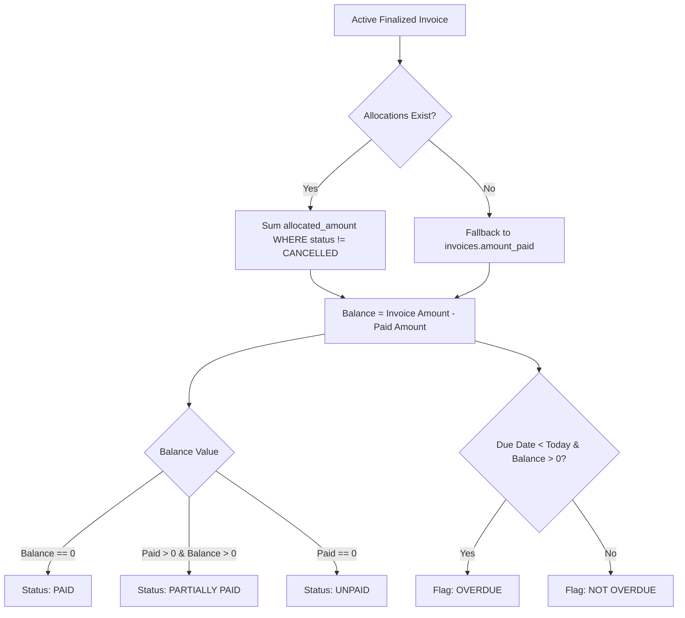

# WTSBill ERP — Invoice Payment Status Report

## 1. Executive Summary & Overview

The **Invoice Payment Status Report** provides an exhaustive, real-time financial tracking and reconciliation dashboard for accounts receivable across WTSBill ERP. It delivers deep operational visibility into finalized customer tax invoices, tracking original billed values, cumulative settled payments, and remaining outstanding balances.

### Key Highlights
- **Location**: Reports & Analytics → Invoice Payment Status (`/reports/invoice-payment-status`)
- **Direct Excel Export**: High-performance OpenXML (`.xlsx`) generation without third-party dependencies.
- **Accrual Reconciliation**: Reconciles invoice grand totals against verified payment allocations, completely isolating cancelled or reversed payments.
- **Single-Expanded Sidebar Accordion**: Fully integrated with the unified navigation controller, automatically highlighting and expanding the Reports menu.

---

## 2. Summary KPI Metrics

The report header features four real-time analytical summary cards calculated from active, non-voided database records conforming to current applied filters:

### Card A: Pending Invoices (Unpaid)
- **Count**: Total count of finalized active invoices where no payments have been received (`Paid Amount = 0`).
- **Total Original Amount**: Sum of original `grand_total` for all unpaid invoices.
- **Total Outstanding**: Remaining balance to be collected (equals Total Original Amount).

### Card B: Fully Paid Invoices
- **Count**: Total count of finalized active invoices where remaining balance has reached ₹0.00.
- **Total Original Amount**: Sum of original `grand_total` for all fully settled invoices.
- **Total Received**: Total cash, bank, or UPI collections allocated to these invoices.

### Card C: Partially Paid Invoices
- **Count**: Total count of finalized active invoices where one or more partial payments have been credited, but an outstanding balance remains (`Paid Amount > 0` and `Remaining Balance > 0`).
- **Total Original Amount**: Sum of original `grand_total` for these partially paid invoices.
- **Total Received**: Sum of all confirmed payment allocations applied to date.
- **Remaining Balance**: Cumulative pending amount remaining to be collected.

### Card D: Total Outstanding (Accounts Receivable)
- **Aggregate Balance**: Sum of `Remaining Balance` across all unpaid and partially paid invoices.
- Provides immediate executive visibility into total market exposure and pending cash flow.

---

## 3. Financial Calculation Rules & Integrity Guards

### Formulas
1. **Invoice Amount**:
   $$\text{Invoice Amount} = \text{Invoice } \mathtt{grand\_total}$$
2. **Paid Amount**:
   $$\text{Paid Amount} = \sum (\text{allocations.allocated\_amount}) \quad \text{for } \mathtt{payments.status} \neq \text{'CANCELLED'} \land \mathtt{payments.deleted\_at} \text{ IS NULL}$$
3. **Remaining Balance**:
   $$\text{Remaining Balance} = \max(0, \text{Invoice Amount} - \text{Paid Amount})$$

### Integrity & Exclusion Rules
- **No Double Counting**: Multiple partial payments allocated to a single invoice are aggregated without duplication.
- **Cancelled / Void Invoices**: Invoices marked with `status = 'CANCELLED'` or `status = 'VOID'`, or possessing a non-null `deleted_at` timestamp, are strictly excluded.
- **Reversed Payments**: Any payment marked `status = 'CANCELLED'` or deleted is excluded from the `Paid Amount`, restoring the original invoice balance.
- **Partial Payment Distinction**: Partially paid invoices are never grouped with fully unpaid pending invoices, ensuring distinct auditing tracks.

---

## 4. Multi-Dimensional Filter Suite

The interactive filter form supports comprehensive filtering parameters that persist across pagination and export:

| Filter Parameter | Form Field | Description |
| :--- | :--- | :--- |
| `date_from` / `date_to` | Date Range | Filters invoices by finalized invoice creation date. |
| `due_date_from` / `due_date_to` | Due Date Range | Filters invoices by contractual payment due date. |
| `invoice_number` | Invoice # | Substring matching on invoice sequence number (e.g., `INV-2026`). |
| `customer_name` | Customer Name | Case-insensitive substring matching on customer company or individual name. |
| `mobile_number` | Mobile # | Matches primary contact phone number. |
| `payment_status` | Status Dropdown | Options: `All`, `Unpaid`, `Partially Paid`, `Paid`. |
| `branch_id` | Operating Branch | Isolates invoices by operating branch or multi-tenant location. |
| `is_overdue` | Overdue Status | Options: `All`, `Overdue Only` (due date passed with balance > 0), `Not Overdue`. |
| `q` | Search Query | Unified keyword search across invoice number and customer name. |

---

## 5. UI Structure & Responsive Data Table

The data table includes real-time styling indicators and direct navigation:
- **Invoice Number**: Direct hyperlink to invoice detail (`/sales/invoices/{id}`).
- **Overdue Visual Accent**: Invoices past due with an open balance feature a soft warning border/background and an `Overdue` pill badge.
- **Payment Status Badges**:
  - `Paid`: Forest green pill badge.
  - `Partially Paid`: Amber/gold pill badge.
  - `Unpaid`: Coral/rose pill badge.
- **Filtered Totals Row**: Displays page and selection totals directly at the base of the table.
- **Responsive Pagination**: Clean page numbering with parameter preservation.

