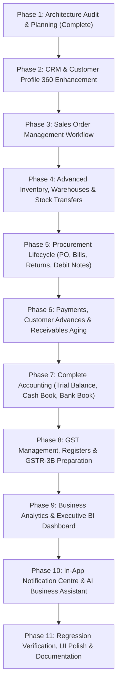

# WTSBill ERP — Comprehensive Module Audit & Gap Analysis

**Date:** 2026-11-05  
**Version:** 2.1 Enterprise  
**Author:** WTSBill ERP Architectural & Engineering Review Board  

---

## 1. Executive Summary

A comprehensive architectural audit of the active WTSBill ERP codebase (`c:\xampp\htdocs\WTSBill`) was performed across:
- **Backend Architecture:** Native PHP, PSR-4 Autoloading, Custom MVC Engine, Route Pipelines, Role-Based Access Control (Gate / RBAC), Database abstraction (Native PDO with prepared statements and nested transaction savepoints).
- **Database Schema:** 124 tables in MariaDB (`wtsbill_db`).
- **Web & API Routes:** 220 registered route endpoints across 20 controllers.
- **Frontend & Layouts:** Server-rendered PHP templates, modern responsive CSS variable design system, modular JavaScript components, session idle draft synchronization.
- **Master Regression Test Suite:** 52 comprehensive test suites comprising **690 / 690 assertions passing with 100% compliance**.

---

## 2. Existing Module Inventory (Fully Implemented & Verified)

The following modules and enterprise capabilities are currently fully implemented, integrated with permissions, and backed by passing regression test suites:

| Module / Subsystem | Controller(s) & Service(s) | Database Tables | Test Suite Coverage | Key Capabilities |
| :--- | :--- | :--- | :--- | :--- |
| **Authentication & Session Security** | `AuthController.php`, `DraftController.php`, `Session.php`, `CsrfMiddleware.php` | `users`, `user_sessions`, `user_drafts` | Sections 8, 12, 13, 14, 48 (52 assertions) | Secure authentication, CSRF protection, 15-min idle timeout, auto-draft saving and recovery, light/dark theme persistence |
| **Multi-Tenancy & Branch Management** | `BranchController.php`, `BranchService.php`, `BranchRepository.php` | `companies`, `branches`, `branch_users`, `branch_settings` | Sections 11, 26 (22 assertions) | Branch switching, branch isolation, branch-wise default settings, branch codes |
| **Role-Based Access Control (RBAC)** | `RoleController.php`, `Gate.php` | `roles`, `permissions`, `role_permissions` | Sections 9, 15, 37 (35 assertions) | Granular permissions (`.view`, `.create`, `.edit`, `.delete`, `.print`, `.export`), role matrices, route gating |
| **Sales Invoicing & Tax Splitting** | `SalesController.php`, `InvoiceNumberService.php`, `QrCodeService.php` | `invoices`, `invoice_items`, `reusable_invoice_numbers` | Sections 19, 21, 27, 30, 32, 44, 51, 52 (82 assertions) | Intra/Inter-state CGST+SGST/IGST calculation, roundoff, dynamic remaining balance UPI QR code, invoice deletion reuse, GST cancellation preservation |
| **Commercial Quotations** | `QuotationController.php`, `InvoiceNumberService.php` | `quotations`, `quotation_items` | Sections 36, 41, 51 (32 assertions) | Quotation lifecycle (`DRAFT`, `SENT`, `ACCEPTED`, `REJECTED`, `EXPIRED`, `CONVERTED`), line item category filtering, duplication, 1-click invoice conversion |
| **Payments & Collections** | `PaymentController.php`, `PaymentService.php` | `payments`, `payment_allocations`, `invoices` | Sections 40, 44 (28 assertions) | Multiple payment installments, cash/UPI/bank/cheque modes, allocation tracking, remaining balance recalculation, printable payment vouchers |
| **360° Customer Profile & Basic CRM** | `CustomerController.php`, `CustomerService.php` | `customers` | Sections 33, 50 (22 assertions) | Customer profile layout, 8 KPI cards, 7 history tabs (Overview, Invoices, Payments, Quotations, Credit Notes, Ledger, Activity), statement CSV export |
| **Supplier & Purchase Bills** | `SupplierController.php`, `PurchaseController.php`, `PurchaseService.php` | `suppliers`, `purchases`, `purchase_items` | Sections 29, 39, 42 (30 assertions) | Supplier registry, purchase bills recording, Dr/Cr balance adjustment, duplicate prevention, tax split calculations |
| **Products & Category Master** | `ProductController.php`, `CategoryManagementTest.php` | `products`, `categories`, `tax_rates` | Sections 24, 38, 43 (36 assertions) | 50 baseline products, category active/inactive toggles, dynamic category line-item dropdowns, HSN/SAC master |
| **Basic Inventory & Stock Adjustments** | `InventoryController.php`, `InventoryService.php` | `products`, `stock_movements`, `stock_adjustments` | Section 28 (12 assertions) | Real-time stock decrement on sales, increment on purchases, manual stock adjustments with movement audit log |
| **Double-Entry Accounting & Ledger** | `AccountingController.php`, `LedgerService.php`, `BalanceSheetService.php` | `chart_of_accounts`, `journal_entries`, `journal_entry_lines`, `ledger_entries` | Sections 27, 49 (24 assertions) | Chart of accounts, manual journals, General Ledger with running balance and account drilldown, Balance Sheet with account drilldown, Profit & Loss |
| **Disaster Recovery & Backup** | `BackupController.php`, `BackupService.php`, `AuditCleanupService.php` | `backup_records`, `restore_logs`, `audit_cleanup_logs` | Section 47 (11 assertions) | Pure PHP ZIP backup (DB + audit archive + config), SHA-256 verification, safe restore with pre-restore safety snapshots, atomic audit retention cleanup |

---

## 3. Missing Module Inventory (To Be Implemented)

The following capabilities are specified in the ERP expansion directive but currently lack complete application controllers, user-facing routes, or frontend views:

1. **Sales Order Management (Full Workflow):**
   - Workflow: `Enquiry / Quotation` &rarr; `Sales Order` &rarr; `Delivery Challan` &rarr; `Tax Invoice`.
   - Dedicated `SalesOrderController.php`, routes `/sales/orders`, views `views/sales/orders/index.php`, `create.php`, `show.php`.
   - Quotation conversion to Sales Order (`POST /sales/quotations/{id}/convert-to-order`).
   - Sales Order conversion to Delivery Challan or Invoice with partial fulfillment tracking (`ordered_quantity`, `delivered_quantity`, `pending_quantity`).
   - Printable Sales Order document (`/sales/orders/{id}/print`).

2. **Advanced Multi-Warehouse & Branch Stock Transfers:**
   - Dedicated `WarehouseController.php` (`/inventory/warehouses`).
   - Warehouse-wise inventory tracking using existing `stock_balances` table.
   - Inter-warehouse and Inter-branch stock transfers (`/inventory/transfers`) with dispatched/received status and approval.
   - Damaged / Quarantined stock tracking and Low-Stock Alert notification banner.
   - Fast-Moving and Slow-Moving product velocity reports.

3. **Purchase Orders, Goods Receipts & Purchase Returns:**
   - Dedicated `PurchaseOrderController.php` (`/purchases/orders`).
   - Complete procurement workflow: `Purchase Order` &rarr; `Goods Receipt (GRN)` &rarr; `Purchase Bill` &rarr; `Purchase Return / Debit Note`.
   - Supplier Return / Debit Note management (`/purchases/returns`, `/purchases/debit-notes`).

4. **Customer Advances & Overdue Receivables Aging:**
   - Unallocated Customer Advance Receipts (`customer_advances`) and subsequent drawdown against newly created invoices.
   - Accounts Receivable Aging report (0-30 days, 31-60 days, 61-90 days, 90+ days overdue).

5. **Financial Statements Expansion:**
   - Trial Balance report (`/reports/trial-balance`).
   - Cash Book & Bank Book registers (`/accounting/cash-book`, `/accounting/bank-book`).
   - Cash Flow Statement (`/reports/cash-flow`).

6. **Comprehensive GST Registers & GSTR-3B Preparation:**
   - GST Sales Register & GST Purchase Register with monthly/quarterly tax summary.
   - GSTR-3B preparation summary report (Outward Taxable Supplies vs Ineligible/Eligible ITC).
   - E-Invoice / E-Way Bill JSON export snapshot generator.

7. **Business Analytics & Executive BI Dashboard:**
   - Executive BI KPI Dashboard with real-time Gross Profit, Net Profit, Stock Valuation, Cash Flow trends, and Branch Comparison.
   - Customer-wise, Product-wise, and Supplier-wise sales/purchase analytics.

8. **Notification Centre:**
   - Central In-App Notification Center (`/notifications`) tracking Overdue Invoices, Low Stock Alerts, Expiring Quotations, and System Events.

9. **AI Business Assistant:**
   - Secure, read-only analytical AI Assistant (`/api/ai/query`) interpreting natural language queries into authorized SQL aggregations.

---

## 4. Partially Implemented Modules

| Module | What Currently Exists | Missing Functionality |
| :--- | :--- | :--- |
| **Delivery Challans** | Basic listing `/sales/challans` in `SalesController.php`, database table `delivery_challans` | Lacks multi-line item creation modal/form, linkage to Sales Orders, quantity fulfillment updates against inventory, and professional printable delivery challan template |
| **Customer Management (CRM)** | Customer register, edit, basic profile, transaction ledger, statement CSV | Lacks multiple shipping/billing addresses (`customer_addresses`), customer tags (`customer_tags`), credit limit enforcement, customer-specific notes, and activity timeline |
| **Supplier Profile & History** | Supplier edit, delete, purchase bill history | Lacks dedicated 360° Supplier Profile page matching customer profile with supplier transaction ledger, payment history, and statement export |
| **Expenses** | Expense CRUD `/expenses` in `ExpenseController.php`, receipt attachment upload | Lacks expense categories master, approval workflow for high-value expenses, and automated double-entry journal creation to expense accounts |
| **General Ledger & Accounting** | General Ledger view `/accounts/ledger`, Balance Sheet `/reports/balance-sheet`, Profit & Loss `/reports/profit-loss` | Lacks Trial Balance, Cash Book, Bank Book, and Cash Flow Statement; Balance Sheet drilldown currently opens General Ledger without pre-filtering account ID in URL query |

---

## 5. Duplicate Functionality to Consolidate

1. **Quotation Conversion Logic:**
   - Currently, `QuotationController::convertToInvoice` directly converts a Quotation to an Invoice.
   - We must enhance this to support the full pipeline: `Quotation` &rarr; `Sales Order` &rarr; `Delivery Challan` &rarr; `Invoice`, while preserving the existing direct 1-click conversion for backward compatibility.
2. **Stock Movement Recording:**
   - Stock movement is currently recorded in multiple places (in `InventoryController` during manual adjustments, and in `SalesController` / `PurchaseController`).
   - Consolidate all inventory changes through a unified `InventoryService::recordMovement(...)` method to ensure uniform audit logs and balance integrity across all warehouses.
3. **Document Sharing & PDF Links:**
   - Consolidated in `CommunicationService` and `PdfGenerator`. Ensure all newly created document types (Sales Orders, Delivery Challans, Purchase Orders) use the existing `PdfGenerator` architecture.

---

## 6. Database Changes & Migration Plan

The existing database `wtsbill_db` already contains 124 tables, including `sales_orders`, `sales_order_items`, `delivery_challans`, `delivery_challan_items`, `warehouses`, `stock_transfers`, `stock_balances`, `purchase_orders`, `purchase_returns`, `debit_notes`, `customer_advances`, and `in_app_notifications`.

### Required Non-Destructive Migrations:
1. **Sales Orders Table Verification & Foreign Keys:**
   - Ensure `sales_orders` has `quotation_id` column for quotation lineage.
   - Ensure `invoices` has `sales_order_id` and `delivery_challan_id` for document traceability.
2. **Customer Credit Limit & Terms:**
   - Verify `credit_limit` (DECIMAL 12,2) and `payment_terms_days` (INT) exist in `customers`.
3. **Stock Transfer Approvals:**
   - Verify `stock_transfers` has `status` enum (`PENDING`, `APPROVED`, `DISPATCHED`, `RECEIVED`, `REJECTED`), `approved_by`, `approved_at`.
4. **Zero Data Loss Guarantee:**
   - All migrations must use `IF NOT EXISTS` / `ADD COLUMN IF NOT EXISTS` syntax to guarantee zero data loss and preserve all historical transactions.

---

## 7. Recommended Implementation Sequence

To ensure complete architectural stability without breaking existing functionality or failing regression tests, the expansion will proceed in the following structured phases:

---

## 8. Risks to Existing Business Logic & Mitigations

| Risk | Affected Systems | Mitigation Strategy |
| :--- | :--- | :--- |
| **Invoice Number Reuse Collision** | Section 52, `InvoiceNumberService` | Never bypass `InvoiceNumberService::acquireInvoiceNumber()`. Sales Orders and Delivery Challans must use their own dedicated sequence generators (`SO-YYYY-XXXX`, `DC-YYYY-XXXX`). |
| **Financial Balance Discrepancies** | Balance Sheet, General Ledger, Customer Balances | Sales Orders and Delivery Challans are unfulfilled commercial commitments and must NOT trigger General Ledger double-entry bookings until converted to a confirmed Tax Invoice. |
| **Negative Inventory Balances** | Product Master, Stock Balances | Prevent stock transfers or sales order dispatches if available stock is insufficient. Always validate `available_quantity = current_stock - reserved_quantity`. |
| **Multi-Branch Data Leaks** | Tenant & Branch Isolation | Enforce `Session::getBranchId()` and `Session::getCompanyId()` across all new controllers, queries, and report aggregations. |
| **Performance Degradation on Large Reports** | General Ledger, GSTR-1, BI Dashboard | Use SQL indexes on `(company_id, branch_id, created_at)` and server-side pagination with streaming CSV exports. |

