# WTSBill ERP — Dependency Map & Architectural Topology

**Document Version:** 1.0.0  
**Generated Date:** 2026-10-10  
**Framework Status:** Zero external framework dependencies (Native PHP 8+ and Native PDO)  

---

## 1. System Runtime & PHP Extension Dependencies

WTSBill ERP requires a standard modern PHP 8+ execution environment with minimal foundational extensions:

### 1.1 Core Runtime Specifications
- **PHP Version:** PHP 8.0 or higher (Active environment: **PHP 8.2+** via `C:\xampp\php\php.exe`)
- **Database Server:** MySQL 8.0+ or MariaDB 10.4.32+ (Active environment: MariaDB/MySQL on `localhost:3306`)
- **Web Server:** Apache 2.4 (XAMPP with `mod_rewrite` enabled) or standalone PHP built-in CLI server (`php -S localhost:8000 public/index.php`)

### 1.2 Required PHP Extensions
| PHP Extension | Criticality | Purpose & Role | Status in Environment |
| :--- | :--- | :--- | :--- |
| `pdo` | **Mandatory** | Base PDO database interface | Enabled & Active |
| `pdo_mysql` | **Mandatory** | MySQL/MariaDB database driver with prepared statement support | Enabled & Active |
| `json` | **Mandatory** | JSON request decoding, API serialization, and JSON response encoding | Enabled & Active |
| `mbstring` | **Mandatory** | Multibyte string processing for Unicode Indian business names & addresses | Enabled & Active |
| `openssl` | **Mandatory** | Cryptographic token generation, session signatures, and JWT HMAC-SHA256 | Enabled & Active |
| `session` | **Mandatory** | Native cookie-based HTTP session state management | Enabled & Active |
| `filter` | **Mandatory** | Input filtering (`filter_var` for email and URL validation) | Enabled & Active |
| `ctype` | Recommended | Fast character classification | Enabled & Active |
| `curl` | Optional | E-Invoice IRP and external Payment Gateway REST API communication | Enabled & Active |

---

## 2. Composer Dependencies (`composer.json`)

The application intentionally maintains an ultra-lean footprint with zero third-party framework packages:

```json
{
    "name": "billwts/erp",
    "description": "WTSBill ERP Rebuilt Native PHP 8+ Accounting & Invoicing Application",
    "type": "project",
    "license": "proprietary",
    "require": {
        "php": ">=8.0"
    },
    "require-dev": {
        "phpunit/phpunit": "^9.5"
    },
    "config": {
        "platform-check": false,
        "optimize-autoloader": true,
        "sort-packages": true
    },
    "autoload": {
        "psr-4": {
            "App\\": "app/"
        },
        "files": [
            "app/Core/helpers.php"
        ]
    }
}
```

- **Production Dependencies:** 0 external packages (eliminates vendor vulnerabilities, memory bloat, and framework upgrade breaking changes).
- **Development Dependencies:** `phpunit/phpunit ^9.5` (optional unit test runner).

---

## 3. Internal Module Dependency & Layering Graph

The architecture enforces unidirectional dependencies, ensuring low coupling and high cohesion:

```mermaid
graph TD
    classDef core fill:#1e293b,stroke:#38bdf8,stroke-width:2px,color:#f8fafc;
    classDef auth fill:#1e3a8a,stroke:#60a5fa,stroke-width:2px,color:#f8fafc;
    classDef masters fill:#064e3b,stroke:#34d399,stroke-width:2px,color:#f8fafc;
    classDef ops fill:#78350f,stroke:#fbbf24,stroke-width:2px,color:#f8fafc;
    classDef finance fill:#4c1d95,stroke:#c084fc,stroke-width:2px,color:#f8fafc;
    classDef reports fill:#831843,stroke:#f472b6,stroke-width:2px,color:#f8fafc;

    subgraph Layer 1: Core Foundation
        Core_Env[App Core Env]:::core
        Core_Config[App Core Config]:::core
        Core_DB[App Core Database]:::core
        Core_Req[App Core Request]:::core
        Core_Resp[App Core Response]:::core
        Core_Router[App Core Router]:::core
        Core_Helpers[App Core Helpers]:::core
    end

    subgraph Layer 2: Authentication & Context
        Auth[Auth & Session Engine]:::auth
        Context[Tenant & Branch Context]:::auth
        RBAC[RBAC Permissions Guard]:::auth
    end

    subgraph Layer 3: Master Data
        Parties[Parties: Customers & Suppliers]:::masters
        Inventory[Products, Units & Warehouses]:::masters
        TaxMaster[GST Rates & Tax Engine]:::masters
        DocNumber[Document Numbering Engine]:::masters
    end

    subgraph Layer 4: Transactional Operations
        Sales[Sales Invoices & Credit Notes]:::ops
        Quotes[Quotations & Sales Orders]:::ops
        Purchases[Purchases & Debit Notes]:::ops
        StockEngine[Stock Movement Ledger]:::ops
        Payments[Payments & Bank Transfers]:::ops
    end

    subgraph Layer 5: Financial Accounting
        COA[Chart of Accounts Master]:::finance
        DoubleEntry[Double-Entry Journal Engine]:::finance
        Ledgers[General Ledger Postings]:::finance
    end

    subgraph Layer 6: Reports & Exports
        GSTR[GSTR-1, 2B, 3B Returns]:::reports
        FinReports[Trial Balance, P&L, Balance Sheet]:::reports
        PrintEngine[Print Templates & PDFs]:::reports
    end

    %% Dependencies
    Auth --> Core_DB
    Auth --> Core_Req
    Context --> Auth
    RBAC --> Auth

    Parties --> Context
    Parties --> Core_DB
    Inventory --> Context
    Inventory --> Core_DB
    TaxMaster --> Core_DB
    DocNumber --> Core_DB

    Sales --> Parties
    Sales --> Inventory
    Sales --> TaxMaster
    Sales --> DocNumber
    Sales --> Core_DB

    Purchases --> Parties
    Purchases --> Inventory
    Purchases --> TaxMaster
    Purchases --> Core_DB

    Quotes --> Parties
    Quotes --> Inventory
    Quotes --> TaxMaster

    StockEngine --> Sales
    StockEngine --> Purchases
    StockEngine --> Inventory

    Payments --> Parties
    Payments --> Sales
    Payments --> Purchases
    Payments --> Core_DB

    DoubleEntry --> COA
    DoubleEntry --> Core_DB
    Sales -.->|Auto Post| DoubleEntry
    Purchases -.->|Auto Post| DoubleEntry
    Payments -.->|Auto Post| DoubleEntry

    FinReports --> DoubleEntry
    FinReports --> Ledgers
    GSTR --> Sales
    GSTR --> Purchases
    PrintEngine --> Sales
    PrintEngine --> Quotes
    PrintEngine --> Purchases
```



---

## 4. External Integrations & Boundary Interfaces

| External System | Integration Protocol | Payload Format | Failure Handling Strategy |
| :--- | :--- | :--- | :--- |
| **GSTIN Portal API** | REST / HTTPS | JSON | Cached in `gstin_validations` table; offline fallback to manual entry |
| **E-Invoice IRP (NIC)** | REST / HTTPS via GSP | JSON with Signed JWT | Async queued job; stores IRN and QR in `e_invoices` |
| **E-Way Bill System** | REST / HTTPS via GSP | JSON | Asynchronous generation; updates `e_way_bills` |
| **Payment Gateways** (Razorpay/Cashfree) | Webhook / HTTPS | JSON HMAC Signed | Idempotent transaction verification via `payment_gateway_webhooks` |
| **WhatsApp Business API** | REST / HTTPS | JSON | Queued notification logged in `communication_messages` |
| **SMTP Mail Server** | SMTP (TLS 587) | MIME HTML | Native `mail()` or socket SMTP; logged in `notification_logs` |

---

## 5. Security Perimeter & Hardening Boundaries

1. **SQL Injection Defense:**
   - 100% prepared statements via Native PDO.
   - Dynamic parameters bound strictly as values, never concatenated into SQL strings.
2. **Error Message Redaction:**
   - `App\Core\Response::error()` automatically sanitizes database exceptions, stripping `SQLSTATE`, `SELECT`, `TABLE`, or schema details before transmitting responses to the client.
3. **Cross-Site Scripting (XSS):**
   - Global escaping helper `e()` invokes `htmlspecialchars($value, ENT_QUOTES | ENT_SUBSTITUTE, 'UTF-8')`.
4. **Cross-Site Request Forgery (CSRF):**
   - Cryptographic session tokens validated on all state-mutating requests (`POST`, `PUT`, `DELETE`).
5. **HTTP Security Headers:**
   - Default security headers emitted on every response:
     - `X-Content-Type-Options: nosniff`
     - `X-Frame-Options: SAMEORIGIN`
     - `X-XSS-Protection: 1; mode=block`
