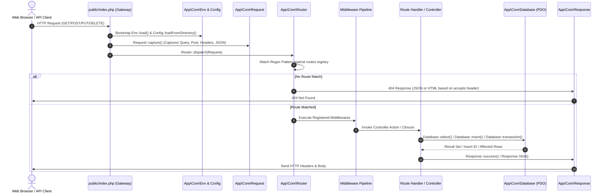

# WTSBill ERP — Route Inventory & Lifecycle Architecture

**Document Version:** 1.0.0  
**Generated Date:** 2026-10-10  
**Runtime:** Native PHP 8+ Router (`App\Core\Router`)  

---

## 1. Request Lifecycle Trace

Every incoming HTTP request to WTSBill ERP follows a deterministic, framework-free execution lifecycle:

### Step-by-Step Lifecycle Description:
1. **Entry Point & Front Controller:** The web server (Apache via `public/.htaccess` or PHP CLI) routes all requests to `public/index.php`.
2. **Environment & Configuration Initialization:** `App\Core\Env::load()` parses `.env` variables; `App\Core\Config::loadFromDirectory()` loads `config/app.php` and `config/database.php` into static memory.
3. **Request Capture:** `App\Core\Request::capture()` instantiates a unified Request object, parsing `php://input` for JSON payloads when `Content-Type: application/json` is detected.
4. **Router Matching:** `App\Core\Router` scans registered routes, evaluating regex patterns for parameterized path segments (e.g., `(?P<id>[^/]+)`).
5. **Middleware Execution:** Configured middlewares execute sequentially (session verification, CSRF token validation, RBAC permission checks). If any middleware returns a `Response` instance, dispatch halts immediately.
6. **Handler Invocation:** Route handler (Closure or `[ControllerClass, 'method']`) executes with injected `Request` and path parameters.
7. **Database Persistence:** Handlers interact with `App\Core\Database`, using PDO prepared statements or atomic transaction callbacks.
8. **Response Transmission:** `App\Core\Response` transmits security headers (`nosniff`, `SAMEORIGIN`, `1; mode=block`), HTTP status code, and content (standardized JSON or rendered HTML) to the client.

---

## 2. Active Discovered Routes (Phase 1 Baseline)

These routes are currently active and registered in the project's source code:

| Method | URI Path | Handler Source | Output Format | Purpose & Description |
| :--- | :--- | :--- | :--- | :--- |
| `GET` | `/` | `public/index.php` (Line 70) | `text/html` | Root ERP welcome and system status dashboard |
| `GET` | `/api/health` | `public/index.php` (Line 51) | `application/json` | System health check reporting DB connection, PHP version, App status |

### Discovered Test Harness Routes (`scripts/run_chunk1_test.php`)
| Method | URI Path | Handler Source | Output Format | Purpose & Description |
| :--- | :--- | :--- | :--- | :--- |
| `GET` | `/health` | `scripts/run_chunk1_test.php` (L155) | `application/json` | Basic exact-match router verification route |
| `GET` | `/customers/{id}` | `scripts/run_chunk1_test.php` (L156) | `application/json` | Parameterized router verification route |
| `POST` | `/api/invoices` | `scripts/run_chunk1_test.php` (L159) | `application/json` | POST request handling & JSON input test route |

---

## 3. Rebuild Application Route Inventory

The following route matrix maps the complete business module architecture across Web Views and REST API endpoints:

### 3.1 Authentication & Profile Routes
| Method | URI Path | Middleware | Target Handler / Controller | Source Planned |
| :--- | :--- | :--- | :--- | :--- |
| `GET` | `/login` | `guest` | `App\Controllers\AuthController::loginForm` | `app/Controllers/AuthController.php` |
| `POST` | `/login` | `guest` | `App\Controllers\AuthController::login` | `app/Controllers/AuthController.php` |
| `POST` | `/logout` | `auth` | `App\Controllers\AuthController::logout` | `app/Controllers/AuthController.php` |
| `GET` | `/profile` | `auth` | `App\Controllers\ProfileController::index` | `app/Controllers/ProfileController.php` |
| `POST` | `/profile` | `auth` | `App\Controllers\ProfileController::update` | `app/Controllers/ProfileController.php` |
| `POST` | `/api/v1/auth/login` | `guest` | `App\Controllers\Api\AuthApiController::login` | `app/Controllers/Api/AuthApiController.php` |
| `GET` | `/api/v1/auth/me` | `auth:api` | `App\Controllers\Api\AuthApiController::me` | `app/Controllers/Api/AuthApiController.php` |

### 3.2 Dashboard & Analytics Routes
| Method | URI Path | Middleware | Target Handler / Controller | Source Planned |
| :--- | :--- | :--- | :--- | :--- |
| `GET` | `/dashboard` | `auth` | `App\Controllers\DashboardController::index` | `app/Controllers/DashboardController.php` |
| `GET` | `/api/v1/dashboard/metrics` | `auth:api` | `App\Controllers\Api\DashboardApiController::metrics` | `app/Controllers/Api/DashboardApiController.php` |

### 3.3 Parties (Customers & Suppliers) Routes
| Method | URI Path | Middleware | Target Handler / Controller | Source Planned |
| :--- | :--- | :--- | :--- | :--- |
| `GET` | `/customers` | `auth` | `App\Controllers\CustomerController::index` | `app/Controllers/CustomerController.php` |
| `GET` | `/customers/create` | `auth` | `App\Controllers\CustomerController::create` | `app/Controllers/CustomerController.php` |
| `POST` | `/customers` | `auth` | `App\Controllers\CustomerController::store` | `app/Controllers/CustomerController.php` |
| `GET` | `/customers/{id}` | `auth` | `App\Controllers\CustomerController::show` | `app/Controllers/CustomerController.php` |
| `GET` | `/customers/{id}/edit` | `auth` | `App\Controllers\CustomerController::edit` | `app/Controllers/CustomerController.php` |
| `POST` | `/customers/{id}` | `auth` | `App\Controllers\CustomerController::update` | `app/Controllers/CustomerController.php` |
| `POST` | `/customers/{id}/delete` | `auth` | `App\Controllers\CustomerController::delete` | `app/Controllers/CustomerController.php` |
| `GET` | `/suppliers` | `auth` | `App\Controllers\SupplierController::index` | `app/Controllers/SupplierController.php` |
| `GET` | `/suppliers/create` | `auth` | `App\Controllers\SupplierController::create` | `app/Controllers/SupplierController.php` |
| `POST` | `/suppliers` | `auth` | `App\Controllers\SupplierController::store` | `app/Controllers/SupplierController.php` |
| `GET` | `/suppliers/{id}` | `auth` | `App\Controllers\SupplierController::show` | `app/Controllers/SupplierController.php` |
| `GET` | `/suppliers/{id}/edit` | `auth` | `App\Controllers\SupplierController::edit` | `app/Controllers/SupplierController.php` |
| `POST` | `/suppliers/{id}` | `auth` | `App\Controllers\SupplierController::update` | `app/Controllers/SupplierController.php` |
| `GET` | `/api/v1/customers` | `auth:api` | `App\Controllers\Api\CustomerApiController::index` | `app/Controllers/Api/CustomerApiController.php` |
| `GET` | `/api/v1/suppliers` | `auth:api` | `App\Controllers\Api\SupplierApiController::index` | `app/Controllers/Api/SupplierApiController.php` |

### 3.4 Products & Inventory Engine Routes
| Method | URI Path | Middleware | Target Handler / Controller | Source Planned |
| :--- | :--- | :--- | :--- | :--- |
| `GET` | `/products` | `auth` | `App\Controllers\ProductController::index` | `app/Controllers/ProductController.php` |
| `GET` | `/products/create` | `auth` | `App\Controllers\ProductController::create` | `app/Controllers/ProductController.php` |
| `POST` | `/products` | `auth` | `App\Controllers\ProductController::store` | `app/Controllers/ProductController.php` |
| `GET` | `/products/{id}/edit` | `auth` | `App\Controllers\ProductController::edit` | `app/Controllers/ProductController.php` |
| `POST` | `/products/{id}` | `auth` | `App\Controllers\ProductController::update` | `app/Controllers/ProductController.php` |
| `GET` | `/inventory/stock-summary` | `auth` | `App\Controllers\InventoryController::stockSummary` | `app/Controllers/InventoryController.php` |
| `GET` | `/inventory/adjustments` | `auth` | `App\Controllers\InventoryController::adjustments` | `app/Controllers/InventoryController.php` |
| `POST` | `/inventory/adjustments` | `auth` | `App\Controllers\InventoryController::storeAdjustment` | `app/Controllers/InventoryController.php` |
| `GET` | `/api/v1/products` | `auth:api` | `App\Controllers\Api\ProductApiController::index` | `app/Controllers/Api/ProductApiController.php` |
| `GET` | `/api/v1/products/{id}/stock` | `auth:api` | `App\Controllers\Api\ProductApiController::stock` | `app/Controllers/Api/ProductApiController.php` |

### 3.5 Sales & Invoicing Routes
| Method | URI Path | Middleware | Target Handler / Controller | Source Planned |
| :--- | :--- | :--- | :--- | :--- |
| `GET` | `/invoices` | `auth` | `App\Controllers\InvoiceController::index` | `app/Controllers/InvoiceController.php` |
| `GET` | `/invoices/create` | `auth` | `App\Controllers\InvoiceController::create` | `app/Controllers/InvoiceController.php` |
| `POST` | `/invoices` | `auth` | `App\Controllers\InvoiceController::store` | `app/Controllers/InvoiceController.php` |
| `GET` | `/invoices/{id}` | `auth` | `App\Controllers\InvoiceController::show` | `app/Controllers/InvoiceController.php` |
| `GET` | `/invoices/{id}/edit` | `auth` | `App\Controllers\InvoiceController::edit` | `app/Controllers/InvoiceController.php` |
| `POST` | `/invoices/{id}` | `auth` | `App\Controllers\InvoiceController::update` | `app/Controllers/InvoiceController.php` |
| `GET` | `/invoices/{id}/print` | `auth` | `App\Controllers\InvoiceController::print` | `app/Controllers/InvoiceController.php` |
| `GET` | `/invoices/{id}/pdf` | `auth` | `App\Controllers\InvoiceController::pdf` | `app/Controllers/InvoiceController.php` |
| `POST` | `/invoices/{id}/cancel` | `auth` | `App\Controllers\InvoiceController::cancel` | `app/Controllers/InvoiceController.php` |
| `GET` | `/api/v1/invoices` | `auth:api` | `App\Controllers\Api\InvoiceApiController::index` | `app/Controllers/Api/InvoiceApiController.php` |
| `POST` | `/api/v1/invoices` | `auth:api` | `App\Controllers\Api\InvoiceApiController::store` | `app/Controllers/Api/InvoiceApiController.php` |

### 3.6 Quotations, Sales Orders & Delivery Challans Routes
| Method | URI Path | Middleware | Target Handler / Controller | Source Planned |
| :--- | :--- | :--- | :--- | :--- |
| `GET` | `/quotations` | `auth` | `App\Controllers\QuotationController::index` | `app/Controllers/QuotationController.php` |
| `GET` | `/quotations/create` | `auth` | `App\Controllers\QuotationController::create` | `app/Controllers/QuotationController.php` |
| `POST` | `/quotations` | `auth` | `App\Controllers\QuotationController::store` | `app/Controllers/QuotationController.php` |
| `GET` | `/quotations/{id}/print` | `auth` | `App\Controllers\QuotationController::print` | `app/Controllers/QuotationController.php` |
| `POST` | `/quotations/{id}/convert-to-invoice` | `auth` | `App\Controllers\QuotationController::convertToInvoice` | `app/Controllers/QuotationController.php` |
| `GET` | `/sales-orders` | `auth` | `App\Controllers\SalesOrderController::index` | `app/Controllers/SalesOrderController.php` |
| `GET` | `/delivery-challans` | `auth` | `App\Controllers\DeliveryChallanController::index` | `app/Controllers/DeliveryChallanController.php` |
| `GET` | `/credit-notes` | `auth` | `App\Controllers\CreditNoteController::index` | `app/Controllers/CreditNoteController.php` |

### 3.7 Purchases & Accounts Payable Routes
| Method | URI Path | Middleware | Target Handler / Controller | Source Planned |
| :--- | :--- | :--- | :--- | :--- |
| `GET` | `/purchases` | `auth` | `App\Controllers\PurchaseController::index` | `app/Controllers/PurchaseController.php` |
| `GET` | `/purchases/create` | `auth` | `App\Controllers\PurchaseController::create` | `app/Controllers/PurchaseController.php` |
| `POST` | `/purchases` | `auth` | `App\Controllers\PurchaseController::store` | `app/Controllers/PurchaseController.php` |
| `GET` | `/purchases/{id}` | `auth` | `App\Controllers\PurchaseController::show` | `app/Controllers/PurchaseController.php` |
| `GET` | `/purchases/{id}/print` | `auth` | `App\Controllers\PurchaseController::print` | `app/Controllers/PurchaseController.php` |
| `GET` | `/debit-notes` | `auth` | `App\Controllers\DebitNoteController::index` | `app/Controllers/DebitNoteController.php` |
| `GET` | `/purchase-orders` | `auth` | `App\Controllers\PurchaseOrderController::index` | `app/Controllers/PurchaseOrderController.php` |

### 3.8 Payments, Banking & Expenses Routes
| Method | URI Path | Middleware | Target Handler / Controller | Source Planned |
| :--- | :--- | :--- | :--- | :--- |
| `GET` | `/payments` | `auth` | `App\Controllers\PaymentController::index` | `app/Controllers/PaymentController.php` |
| `GET` | `/payments/create` | `auth` | `App\Controllers\PaymentController::create` | `app/Controllers/PaymentController.php` |
| `POST` | `/payments` | `auth` | `App\Controllers\PaymentController::store` | `app/Controllers/PaymentController.php` |
| `GET` | `/expenses` | `auth` | `App\Controllers\ExpenseController::index` | `app/Controllers/ExpenseController.php` |
| `GET` | `/expenses/create` | `auth` | `App\Controllers\ExpenseController::create` | `app/Controllers/ExpenseController.php` |
| `POST` | `/expenses` | `auth` | `App\Controllers\ExpenseController::store` | `app/Controllers/ExpenseController.php` |
| `GET` | `/banking/accounts` | `auth` | `App\Controllers\BankingController::index` | `app/Controllers/BankingController.php` |

### 3.9 Double-Entry Accounting Routes
| Method | URI Path | Middleware | Target Handler / Controller | Source Planned |
| :--- | :--- | :--- | :--- | :--- |
| `GET` | `/accounting/chart-of-accounts` | `auth:accountant` | `App\Controllers\AccountingController::chartOfAccounts` | `app/Controllers/AccountingController.php` |
| `GET` | `/accounting/journal-entries` | `auth:accountant` | `App\Controllers\AccountingController::journalEntries` | `app/Controllers/AccountingController.php` |
| `GET` | `/accounting/journal-entries/create` | `auth:accountant` | `App\Controllers\AccountingController::createJournal` | `app/Controllers/AccountingController.php` |
| `POST` | `/accounting/journal-entries` | `auth:accountant` | `App\Controllers\AccountingController::storeJournal` | `app/Controllers/AccountingController.php` |
| `GET` | `/accounting/ledger/{accountId}` | `auth:accountant` | `App\Controllers\AccountingController::viewLedger` | `app/Controllers/AccountingController.php` |

### 3.10 Reports & Tax Compliance Routes
| Method | URI Path | Middleware | Target Handler / Controller | Source Planned |
| :--- | :--- | :--- | :--- | :--- |
| `GET` | `/reports/trial-balance` | `auth:accountant` | `App\Controllers\ReportController::trialBalance` | `app/Controllers/ReportController.php` |
| `GET` | `/reports/profit-loss` | `auth:accountant` | `App\Controllers\ReportController::profitLoss` | `app/Controllers/ReportController.php` |
| `GET` | `/reports/balance-sheet` | `auth:accountant` | `App\Controllers\ReportController::balanceSheet` | `app/Controllers/ReportController.php` |
| `GET` | `/reports/gstr-1` | `auth:accountant` | `App\Controllers\ReportController::gstr1` | `app/Controllers/ReportController.php` |
| `GET` | `/reports/gstr-2` | `auth:accountant` | `App\Controllers\ReportController::gstr2` | `app/Controllers/ReportController.php` |
| `GET` | `/reports/gstr-3b` | `auth:accountant` | `App\Controllers\ReportController::gstr3b` | `app/Controllers/ReportController.php` |
| `GET` | `/reports/stock-ledger` | `auth` | `App\Controllers\ReportController::stockLedger` | `app/Controllers/ReportController.php` |

### 3.11 Administration, Users & Settings Routes
| Method | URI Path | Middleware | Target Handler / Controller | Source Planned |
| :--- | :--- | :--- | :--- | :--- |
| `GET` | `/settings/company` | `auth:admin` | `App\Controllers\SettingsController::company` | `app/Controllers/SettingsController.php` |
| `POST` | `/settings/company` | `auth:admin` | `App\Controllers\SettingsController::updateCompany` | `app/Controllers/SettingsController.php` |
| `GET` | `/settings/branches` | `auth:admin` | `App\Controllers\SettingsController::branches` | `app/Controllers/SettingsController.php` |
| `GET` | `/users` | `auth:admin` | `App\Controllers\UserController::index` | `app/Controllers/UserController.php` |
| `GET` | `/roles` | `auth:admin` | `App\Controllers\RoleController::index` | `app/Controllers/RoleController.php` |
