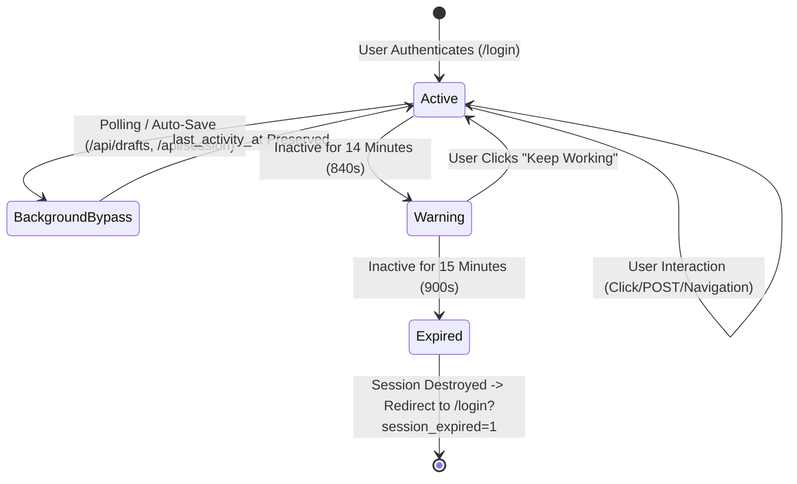

# WTSBill ERP — 15-Minute Idle Session Timeout & Draft Auto-Saving Policy

**Document Version:** 1.0.0  
**Effective Date:** 2026-11-04  
**Author:** Principal Security Architect & Lead Engineer  
**Applies To:** All authenticated sessions in WTSBill ERP  

---

## 1. Overview & Threat Defense Rationale

To comply with enterprise financial software security standards (including RBI, GSTN, and SOC-2 guidelines), unattended sessions present an acute authorization risk. If an operator walks away from a billing workstation or public terminal, unauthorized parties must not be permitted to view sensitive customer data, alter tax invoices, or disburse supplier funds.

WTSBill ERP enforces an automatic **15-minute (900 seconds) inactivity timeout** combined with non-intrusive **in-flight draft auto-saving**.

---

## 2. Server-Side Inactivity Lifecycle

### Inactivity Enforcement Rules:
1. **Configured Lifetime:** Defined in `config/session.php` (`'lifetime' => 900`).
2. **Server-Side Validation:** `AuthService::check()` compares `time() - Session::get('last_activity_at')`. If the elapsed time exceeds 900 seconds, `AuthService::logout()` is immediately called, flushing the session.
3. **Background Request Exemption:**
   - Any background AJAX request that contains `X-Session-KeepAlive: 0` or `X-Background: 1`, or targets routes matching `/api/drafts/*`, `/api/session/*`, or `/api/health`, **does not refresh** `last_activity_at`.
   - This prevents background pollers, toast checks, or draft saves from indefinitely keeping an unattended session alive.

---

## 3. Client Watchdog & Multi-Tab Synchronization

The frontend watchdog is implemented in `public/assets/js/session-idle.js` and loaded globally in `views/layouts/app.php`.

### Multi-Tab Synchronization (`localStorage`):
- Tab activity updates `localStorage.setItem('wtsbill_last_active', Date.now())`.
- Storage change listeners across all open browser tabs sync the inactivity timer instantly. Typing or scrolling in Tab A resets the countdown in Tab B and Tab C.
- If Tab A logs out or expires, all other open tabs immediately detect the event and redirect to `/login?session_expired=1`.

### 60-Second Countdown Warning Modal:
- At 14 minutes of inactivity (840 seconds), an accessible countdown modal appears:
  > **Session Expiring Due to Inactivity**  
  > You have been idle for 14 minutes. For security, your session will automatically terminate in **XX seconds**. Any unsaved work has been secured as a draft.  
  > `[Stay Logged In]` `[Log Out Now]`
- Clicking **Stay Logged In** calls `POST /api/session/touch` to refresh the session.
- If the countdown reaches 0, the client redirects to `/login?session_expired=1`.

---

## 4. In-Flight Form Draft Auto-Saving & Recovery

### Zero Financial Side-Effects:
Form drafts are stored exclusively in the isolated `user_drafts` database table. Drafts:
- **Never** create rows in `invoices`, `quotations`, `purchases`, or `customers`.
- **Never** modify customer account balances or Accounts Receivable.
- **Never** generate journal entries in `journal_entries` or `journal_entry_lines`.

### Supported Forms:
- Sales Tax Invoices (`/sales/invoices/create`)
- Quotations & Commercial Estimates (`/sales/quotations/create`)
- Purchase Bills (`/purchases/bills`)
- Customer Onboarding (`/customers/create`)
- Supplier Registration (`/suppliers`)
- Product Creation (`/inventory/products`)
- Expense Vouchers (`/expenses`)

### Recovery Workflow:
1. When a user re-opens a form after an expired session, `session-idle.js` queries `GET /api/drafts/check?form_key={key}`.
2. If an active draft exists, a non-intrusive recovery banner renders atop the form:
   > ℹ️ **Unsaved draft recovered from [date/time]**. Would you like to restore your entered items and fields?  
   > `[Restore Form Data]` `[Discard Draft]`
3. Clicking **Restore** populates all form controls and line item rows.
4. Clicking **Discard** or successfully submitting the completed form calls `POST /api/drafts/discard` to purge the temporary draft.

